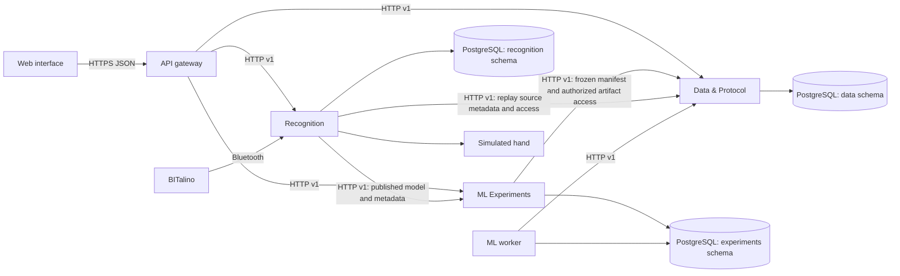
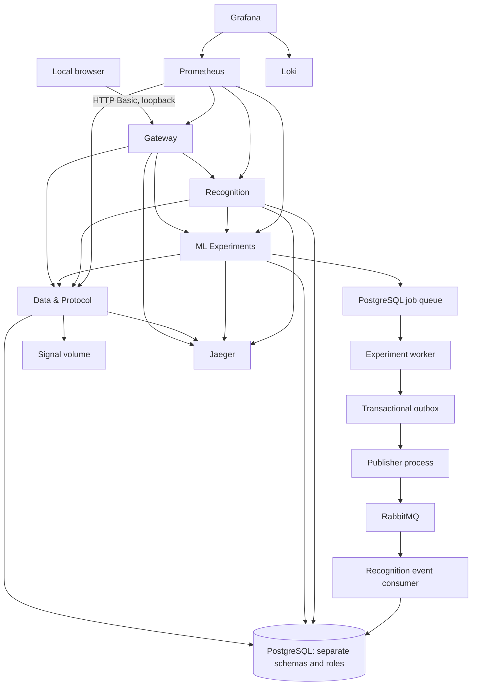

# Service Architecture

Status: partially implemented prototype. Three independently packaged services, a local gateway, isolated PostgreSQL schemas, synthetic source-only LDA evaluation, replay and RabbitMQ model events are implemented. The existing prototype remains in its original PostgreSQL schema; it has not been migrated to the service schemas. This document describes the target and explicitly identifies remaining work.

## Goals

The system separates data stewardship, experimental computation and low-latency recognition. Recognition must continue an active replay when the experiment service becomes unavailable, provided the model and input are already available locally. Training may run for longer than an HTTP request. The acquisition process must remain close to the Bluetooth device.

## Business services

| Service | Bounded context | Owns | Does not own |
| --- | --- | --- | --- |
| Data & Protocol | Source ingestion, recording metadata and experimental data allocation | Participants, source versions, recording metadata, channels, labels, canonical signal identity, artifact references, protocol versions, split manifests, calibration subsets | Models, experiment execution and recognition sessions |
| ML Experiments | Training, adaptation, evaluation and publication | Experiment jobs, training inputs and immutable provenance snapshots, feature/model configuration, model versions, evaluation results, model artifacts | Source recordings and split definitions |
| Recognition | Live or recorded inference and simulated-hand commands | Recognition sessions, local model cache metadata, session status and timing summaries | Model training and canonical source metadata |

The experiment worker is a process in the ML context, not a fourth business service. A local recognition deployment hosts the device adapter when BITalino is attached locally. An API gateway and the web interface are infrastructure and are not counted as business services.

Gateway and worker arrows are included when calculating synchronous request paths. Long-running work is queued: the client receives a job ID rather than waiting for training. No synchronous request may call more than three business services; the first critical flow uses a direct ML-to-Data request and no circular dependency. Exact gateway counting and the institution's interpretation should be confirmed during review.

## Data ownership and migration

One PostgreSQL instance may contain three schemas, but each service has its own login role with access only to its schema. Cross-service references are immutable external IDs, not cross-schema foreign keys. No service queries another service's schema. Operations spanning services use versioned API contracts and local transactions; no distributed transaction or 2PC is used. Administrative migrations are separate from application roles.

The current `myoprosthesis` schema has cross-domain foreign keys and triggers. It cannot be split by renaming schemas alone. Before moving data:

1. Inventory every table, trigger, foreign key, view and grant, and assign its owner. Keep the original database as a read-only migration source and take a verified backup.
2. Create new service-owned schemas and migrations. Data & Protocol retains participant-role, overlapping-unit, freeze and calibration invariants within one transactional boundary.
3. ML stores a snapshot of the frozen manifest ID, version, checksum, protocol and selected unit/segment IDs returned by Data & Protocol. It validates them before starting and checks that downloaded artifacts match their hashes. Snapshot immutability and API compatibility must be tested without cross-schema joins.
4. Recognition stores the published model ID, artifact checksum, feature contract and local session state. It verifies the downloaded artifact and compatibility before a session starts. It does not query experiment tables.
5. Backfill in dependency order, compare counts, IDs and checksums, exercise failure and recovery cases, then switch reads and writes service by service. Define rollback and reconciliation before any production migration. Do not alter existing research data until this procedure has been tested on a copy.

Ownership of canonical signals and split units remains in Data & Protocol so freeze and overlap checks remain atomic. ML must not treat a snapshot as proof of actual training inputs: the worker also validates the data it passes to fit. Immutable provenance snapshots and artifact hashes make later auditing possible when the source service is temporarily unavailable.

## Contracts and failure behaviour

Contracts use versioned JSON APIs and OpenAPI documents owned by each service. Large signal and model files are transferred as artifacts rather than embedded in JSON. The service that owns an artifact authorizes access and supplies its checksum; the consumer verifies downloaded bytes. Artifact transfer method, retention, access control and deployment topology are **TBD**.

The first vertical slice is: create synthetic source records and labels → freeze a manifest → submit an experiment job referencing that manifest → inspect job status and a persisted result. The result must be computed from actual input; a mock model or a static response may only be used in clearly labelled test fixtures, never as the production API implementation. Later slices add calibration, recognition and real datasets.

Each downstream call has an explicit timeout. Retry only operations that are safe or use operation-scoped idempotency keys; use a bounded retry count and backoff. Exhaustion returns a meaningful error and leaves a recoverable job state. An already running recognition session uses its verified local model and input; failure or invalid input causes neutral output with a visible reason. Service-specific endpoints provide liveness and readiness. Structured logs include a propagated correlation ID without signals, secrets or identifying information.

The gateway must provide a single entry point, authentication/authorization and per-client rate limiting. Local-only development and external deployment have separate configurations. Production must be accessible to external users, with authenticated access and appropriately protected data. Hosting, identities, TLS termination, consent and permitted data storage are **TBD**.

## Current local deployment

The Compose observability profile is local and optional. OpenTelemetry exports HTTP traces to Jaeger and application logs to Loki when explicitly enabled; Prometheus scrapes service metrics. Jaeger's local storage is in memory. Alertmanager receives local alerts but has no external notification destination. The development gateway uses HTTP Basic over loopback; external access requires TLS, authorization and an approved deployment design.

## Feature compatibility

The service boundary does not permit a shared business-logic library. ML Experiments and Recognition implement feature extraction independently. The initial `time-domain-4ch-v1` contract uses four channels, no filter, 200 ms windows, 100 ms steps and channel-major MAV, RMS, waveform length, zero crossings and slope sign changes with zero thresholds. The current cross-service test compares synthetic vectors with absolute and relative tolerance `1e-12`; this is a development tolerance, not yet validated across hardware or software environments. A model includes its sample rate and feature configuration; Recognition rejects unsupported versions and incompatible inputs. Filtering, thresholds and suitability for measured signals are **TBD**.

## Target for highest marks

- **Async:** RabbitMQ domain events, including `ModelPublished`; publisher confirms, durable queues, dead-letter handling, idempotent consumers and a transactional outbox for events that must follow committed state. Training jobs and events have distinct ownership and retry semantics.
- **Resilience:** explicit deadlines, bounded exponential backoff, circuit breaking and isolation of live recognition from slow experiment work.
- **Observability:** OpenTelemetry tracing, correlation IDs, centralized structured logs, Prometheus metrics and Grafana dashboards. Separate application processing time, window accumulation and rendering time. Configure alerting through an approved notification destination; destination and hosting are **TBD**.
- **Backend:** SQLAlchemy ORM in each service's persistence layer, centralized error handling, JSON contracts, meaningful non-static APIs, Redis only for a demonstrated cacheable workload, dependency security scanning and coverage gates. The minimum coverage target is 70%; the deployment quality gate target is at least 80%.
- **CI/CD:** separate service images, registry publication and automated deployment after passing tests, security checks and coverage gates. Secret injection uses environment or a secret store. Registry, deployment environment and authorization mechanism are **TBD**. External actions are not configured until the environment is selected.

## Validation and implementation order

1. Define source-owned contracts and schemas; implement a real synthetic import and split-freeze API with database integration tests and OpenAPI.
2. Implement experiment submission and a worker that retrieves the frozen manifest from Data & Protocol, produces a real computed result and persists its provenance in its own schema. Add service contract tests and failure cases.
3. Implement Recognition replay with a locally cached, verified model and independent feature extraction. Demonstrate ML service failure during active replay and neutral behaviour on input failure.
4. Add gateway, service credentials, rate limits and independently built images. Run local integration and access-control tests with separate database roles.
5. Add messaging, resilience, centralized observability and deployment automation; measure 80% coverage and test recovery, duplicate events and broken dependencies.
6. Complete architecture and deployment diagrams against the deployed system, publish OpenAPI/AsyncAPI contracts, document service migration and verify requirements with evidence.

This document is a target, not evidence that the rubric is satisfied. The existing synthetic rehearsal stores a placeholder model and unavailable metrics; it is not the real API flow described above.

The newer service flow trains an actual source-only LDA on synthetic recordings and replays predictions. It remains a research prototype: target-only and personalised models, hardware acquisition, hand rendering, model caching, robust job recovery, authenticated inter-service calls, production deployment and independent experimental validation are not complete. The current service migrations and data must not be used for actual participant data until provenance, consent, access and retention rules are implemented and reviewed.
