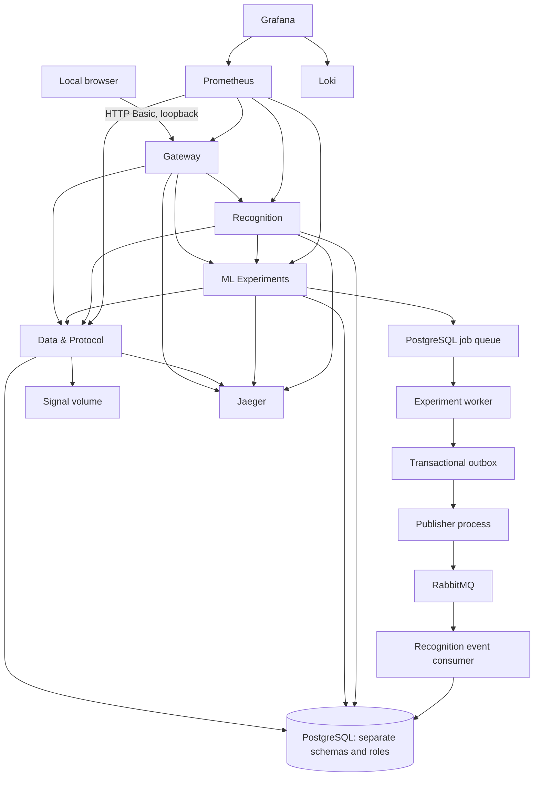

# Service Architecture

Status: partially implemented prototype. Three independently packaged services, a local gateway, isolated PostgreSQL schemas, synthetic source-only LDA evaluation, replay and RabbitMQ model events are implemented. The existing prototype remains in its original PostgreSQL schema; it has not been migrated to the service schemas. This document describes the target and explicitly identifies remaining work.

## Accepted target deployment

[ADR-001](../docs/ARCHITECTURE_DECISIONS.md) supersedes earlier physical-placement and client-delivery proposals. See the [deployment diagram](../docs/DEPLOYMENT_ARCHITECTURE.md), [PNG](../docs/DEPLOYMENT_ARCHITECTURE.png) and [design PRD](../docs/DESIGN_PRD.md).

| Boundary | Responsibility |
| --- | --- |
| Cloud | Operator accounts/authorization, research metadata/protocols, model registry/artifacts, experiment results, job coordination and adaptive web portal. |
| Powerful local workstation | General LDA/SVM/MLP training and batch experiments/evaluation through reproducible worker tooling. |
| Electron client | Bundled local React UI/Python/PLUX SDK, acquisition, calibration/adaptation, live/replay, virtual hand and recoverable local records. |

General training is not cloud computation. Per-window inference never depends on cloud requests. The prepared Electron session does not depend on an available training workstation. Mac mini hardware is a hosting option, not a mandatory architectural node. Provider and resource sizing remain open.

## Business ownership and execution

| Domain | Cloud-owned state | Execution |
| --- | --- | --- |
| Data & Protocol | Participants/source identities, recording/artifact metadata, labels, class sets, protocols, frozen manifests and published calibration subsets | Cloud validation/publication; Electron collects/reviews local samples and submits pending data. |
| ML Experiments | Jobs, input snapshots, configuration, model/version metadata, evaluations and package publication | General/batch computation on the local training workstation; interactive calibration/adaptation in Electron. |
| Recognition | Centrally published session summaries/results where applicable | Local Electron Python runtime: SDK, ordered input processing, prediction/commands, neutral handling and timing. |

Operator identity is cloud-managed and distinct from participants; provider/session/schema ownership must be specified. This does not require inventing another independently deployed business service. Web and Electron are separate client surfaces with reusable UI code.

## Target job and publication contract

The cloud accepts an authenticated research job with frozen inputs and a stable ID. A separately installed local worker claims an eligible attempt, obtains authorized input artifacts, verifies hashes/contracts, reports progress/heartbeat and uploads results. The cloud validates completeness and publishes metadata/artifacts transactionally within the owning service boundary. It does not execute general fitting. Unavailable workers leave queued/unavailable work; disconnected or stale attempts follow explicit recovery rules.

External workers and Electron do not access PostgreSQL directly or query another service's schema. Use scoped API credentials, operation-specific idempotency and bounded retries. Source-only/general models and their required adaptation material are published as versioned compatible packages.

Local adaptation produces a personal model with source parent, exact target calibration membership, method/configuration and integrity metadata. LDA statistics, SVM fixed source pools and MLP replay pools must be included where the specified method requires them. Frozen target tests never enter fitting or adaptation. Local results remain pending until validated publication; retries do not create duplicates or mutate frozen versions.

## Local session and client contract

Electron launches, monitors and stops its bundled Python/SDK process automatically. The renderer loads bundled assets and uses a restricted local interface, not arbitrary process/filesystem access. User installation requires no Python, Docker or manually started local worker. Ship separate tested native OS/CPU installers and a reproducible general-training tool.

Acquisition, calibration/adaptation and live/replay remain local. Prepared authorized sessions continue during cloud loss and synchronize later. First account access and uncached downloads require connectivity; offline authorization expiry/revocation policy must be designed. Device/input/processing failure and pause/stop produce neutral with a visible reason; failure requires explicit restart. Switching model versions occurs between sessions.

## Data ownership and migration

Current PostgreSQL contains service-owned `data_protocol`, `ml_experiments` and `recognition` schemas with separate logins. Cross-service identifiers are external references, not cross-schema foreign keys. The historical `myoprosthesis` schema is a separate implementation and cannot be migrated by renaming schemas.

Before migration/publication changes, inventory ownership, back up and test on a copy; preserve IDs/checksums/provenance and compare counts/relationships. Frozen input membership and artifact bytes must match what the worker actually passes to fit. New migrations provide operator/client/session identity, model/run/package/evaluation registries and recording/desktop publication records. Their diagrams/dictionary and acceptance checks are in [database review](../database/README_TEACHER.md). Integrating these records into HTTP authorization, worker protocols and Electron synchronization remains application work.

Keep large artifacts in controlled storage and authoritative metadata/results in the owning cloud database. Define upload/verification/commit/reconciliation order and protect originals; cloud storage does not authorize unrestricted raw participant-data upload. Backup/retention and offline pending-data recovery are separate obligations.

## Current local deployment — development evidence

The diagram below describes the existing single-host Compose. In particular its worker has local database access and its Recognition service is an HTTP replay service. These are current implementation facts, not the accepted cross-machine APIs or packaged desktop runtime. Existing Compose must be split before target deployment.

The Compose observability profile is local and optional. OpenTelemetry exports HTTP traces to Jaeger and application logs to Loki when explicitly enabled; Prometheus scrapes service metrics. Jaeger's local storage is in memory. Alertmanager receives local alerts but has no external notification destination. The development gateway uses HTTP Basic over loopback; external access requires TLS, authorization and an approved deployment design.

## Feature compatibility

The service boundary does not permit a shared business-logic library. ML Experiments and Recognition implement feature extraction independently. The initial `time-domain-4ch-v1` contract uses four channels, no filter, 200 ms windows, 100 ms steps and channel-major MAV, RMS, waveform length, zero crossings and slope sign changes with zero thresholds. The current cross-service test compares synthetic vectors with absolute and relative tolerance `1e-12`; this is a development tolerance, not yet validated across hardware or software environments. A model includes its sample rate and feature configuration; Recognition rejects unsupported versions and incompatible inputs. Filtering, thresholds and suitability for measured signals are **TBD**.

## Target for highest marks

- **Async:** RabbitMQ domain events, including `ModelPublished`; publisher confirms, durable queues, dead-letter handling, idempotent consumers and a transactional outbox for events that must follow committed state. Training jobs and events have distinct ownership and retry semantics.
- **Resilience:** explicit deadlines, bounded exponential backoff, circuit breaking and isolation of live recognition from slow experiment work.
- **Observability:** OpenTelemetry tracing, correlation IDs, centralized structured logs, Prometheus metrics and Grafana dashboards. Separate application processing time, window accumulation and rendering time. Configure alerting through an approved notification destination; destination and hosting are **TBD**.
- **Backend:** SQLAlchemy ORM in each service's persistence layer, centralized error handling, JSON contracts, meaningful non-static APIs, Redis only for a demonstrated cacheable workload, dependency security scanning and coverage gates. The minimum coverage target is 70%; the deployment quality gate target is at least 80%.
- **CI/CD:** separate service images, registry publication and automated deployment after passing tests, security checks and coverage gates. Secret injection uses environment or a secret store. Registry, deployment environment and authorization mechanism are **TBD**. External actions are not configured until the environment is selected.

## Validation and implementation order

1. Preserve existing synthetic regression/database tests and version the accepted contracts. Establish the source/channel/class protocol without silently changing the four-channel requirement.
2. Verify direct SDK acquisition on the actual M1 Pro/macOS/device combination and complete local neutral/failure behaviour.
3. Build Electron process lifecycle and reproducible native installers; verify clean-machine replay without developer tools.
4. Implement/version adaptation packages and local LDA/SVM/MLP personalisation; measure package size, duration and memory. Keep target-only and frozen-test comparisons matched.
5. Add cloud operator identities/authorization, remote-worker job/input/result APIs and permitted artifact publication. General fitting remains local.
6. Implement prepared/offline client state and idempotent synchronization; verify expiry, duplicate retries, partial uploads and cloud loss during live.
7. Reproduce full training outside the author's workstation, run real-data experiments, validate cloud adaptive UI/desktop layouts, measure timing/recovery and rehearse submission.

The historical synthetic rehearsal contains a placeholder model and unavailable metrics. The newer service flow computes actual source-only LDA on synthetic data. Neither establishes real-data research validity. Electron, SDK live integration, full personalisation/target-only/SVM/MLP, operator identities, remote-worker APIs and synchronization remain incomplete. Existing replay caches, hand UI and job heartbeats are implemented in narrower development paths and must not be presented as the completed target.
