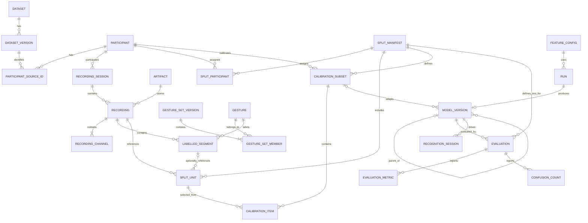

# Logical database model

Status: proposed logical design. Names, keys and enforcement details must be verified in migrations and integration tests. The requirements in `docs/DATABASE_REQUIREMENTS.md` remain authoritative. This document does not claim that a database has been implemented.

## Architecture and scope

PostgreSQL 18 stores operational state, references, experiment provenance and queryable results. Large signals, cached features, models and optional detailed prediction events live in controlled file or object storage. An artifact record stores a stable storage key, size and checksum; a storage key is not evidence that the file exists or is accessible. SQLAlchemy 2.0 with psycopg 3 is the planned Python access layer; Alembic manages versioned migrations. Exact dependency and image versions will be pinned and tested during implementation.

Participants are pseudonymous; identity and consent information belong in a separate managed store. A participant's cross-source identity may be unknown, which must be documented as a limitation rather than assumed absent. Application accounts, if introduced, are separate from research participants.

## Logical relationships

The diagram highlights the provenance path. Junction tables and additional relationships are described in the dictionary. Cardinalities show optionality at this level; the dictionary and eventual DDL define conditional requirements.

## Design decisions and invariants

1. **Recording identity.** An imported recording has a source-version-specific external key. A canonical signal identity and original sample coordinates must be preserved independently of import identity so re-importing the same signal cannot bypass split checks. The identity derivation and treatment of transformed copies must be specified when the DB2 importer is designed; checksums of arbitrary containers alone do not prove signal identity.
2. **Sample intervals.** Segments use half-open `[start, end)` integer sample intervals relative to the canonical recording. Whole-recording units resolve to the full interval. Segment boundaries are validated against the recording's sample count. Overlap checks compare the same canonical signal, including duplicate imports.
3. **Manifest membership.** Each participant has one category per manifest. Each unit has one permitted role consistent with its participant's category. Source, development and final target participants cannot overlap within a manifest. Calibration and test for the same target are allowed only on non-overlapping units. Versioned protocol rules define the precise unit and role policy.
4. **Freeze.** A manifest is mutable only in draft. Every membership mutation and freeze operation must acquire the same manifest-level lock before checking state or membership. A database function returns conflict identifiers; a procedure validates and freezes atomically. A trigger guards direct changes, including updates, deletes and moving rows between manifests. Canonical serialization, ordering, included hashes and checksum algorithm will be defined before implementing freeze; frozen content and referenced provenance must not be mutable in a way that invalidates the checksum. Corrections create a new version.
5. **Budgets.** A subset belongs to one frozen manifest and target participant; each item must resolve to an eligible calibration unit and labelled repetition for that participant. A versioned selection order or explicit parent relation must establish nested budgets. Count distinct repetitions and compute unique duration as the union of sample intervals, not a sum of potentially overlapping segments. Completeness of required classes is checked before adaptation.
6. **Model and evaluation provenance.** A run records its inputs, feature configuration, parameters, software versions and seed. A model refers to its producing run and artifact; personalised models also reference a source parent and calibration subset, and target-only models reference the same subset used for comparison. An evaluation identifies its model, target, frozen manifest, protocol and exact test membership. A comparison must check compatibility, including test membership, class mapping and feature/protocol versions, and expose missing runs.
7. **Publication and recovery.** Long computation happens outside an open database transaction. Write an artifact to a temporary location, publish it under a stable key, verify checksum and availability, then transactionally publish its metadata, result references and terminal job state. File storage and PostgreSQL do not share an atomic transaction: a documented reconciliation process detects orphan files and missing artifacts. Retry uses operation-scoped idempotency keys; deliberate research reruns receive new IDs.
8. **Recognition.** A session refers to a published model and input configuration. Replay identifies its source recording or immutable input manifest. State, stop reason and aggregate timing counts are queryable; detailed events may be a versioned artifact. Neutral-state safety is enforced by the application and tested end to end, not assumed from database constraints.

## Integrity and access boundaries

Database constraints enforce identity, foreign keys, allowed values and published-state invariants, including checks on direct SQL writes. Cross-row rules requiring serialization use procedures and triggers. The service validates actual inputs and permitted fit roles before windowing and training. Integration tests must cover both boundaries, including concurrent freeze and mutation.

Planned roles are `app_read`, `app_write` and a separate migration/administration role. Neither application role is a superuser or schema owner. Grants are applied and tested for new objects as well as existing ones; access to sensitive artifacts is controlled separately from metadata access. Direct identifiers and consent are not stored in this operational schema. Authorized deletion and backup/retention policy need a documented procedure compatible with provenance restrictions.

## Open design work

- Specify exact identity rules for DB2 repetitions, cross-import signal identity and source label mapping after inspecting real input files.
- Define canonical manifest serialization, checksum scope, immutable dependencies and the precise lock/trigger implementation.
- Define calibration selection order, test membership snapshot and compatibility rules at protocol version level.
- Select storage and backup details, interruption detection, role grants and the exact artifact reconciliation process.
- Produce physical DDL, a column-level dictionary, SQL migration output, reference seeds and acceptance tests together so documentation and schema stay aligned.
