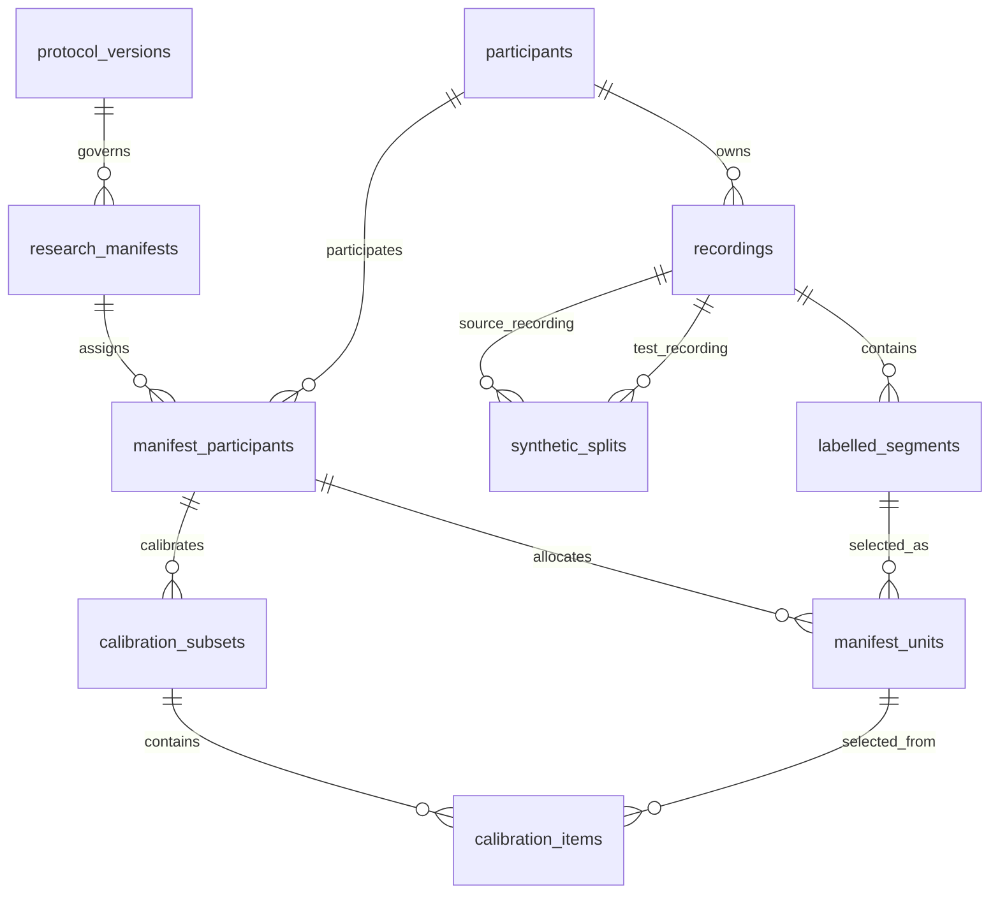
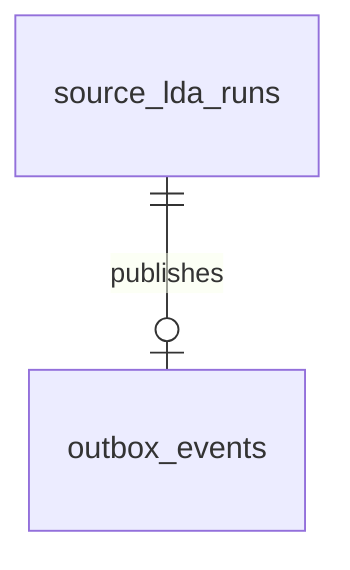
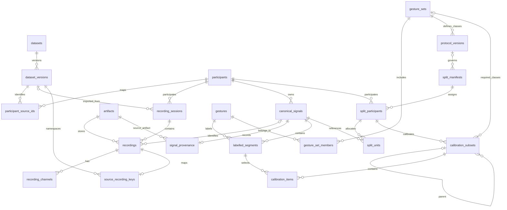
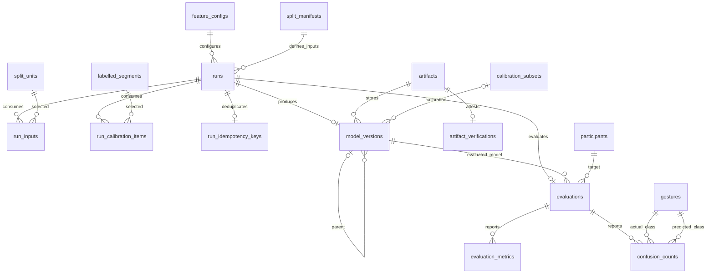

# Logical database model

## Accepted target versus existing schema

The accepted [ADR-001](../docs/ARCHITECTURE_DECISIONS.md) now has additive persistence migrations: `identity/0001`, `data_protocol/0006`, `ml_experiments/0007` and `recognition/0003`. They add operator/client/session records, publication provenance/receipts, a generic run/model/package/evaluation registry and desktop reports. See the [teacher guide](README_TEACHER.md), [current logical diagrams](SERVICE_MODEL.md) and [generated service dictionary](SERVICE_DATA_DICTIONARY.md). Operator authentication and desktop recording synchronization now have HTTP implementations. Authenticated workstation job/artifact APIs, model adaptation and terminal desktop-report synchronization remain application work; schema support alone does not establish a completed research runtime.

This document describes implemented relationships. The migrator installs four persistence schemas, including the new identity boundary; this does not add a fourth running business API. The original `myoprosthesis` schema is a separate implementation used by the earlier backend. See the [data dictionary](DATA_DICTIONARY.md) for fields and keys and the [database overview](README.md) for migration commands.

## Current service schemas

Each service uses its own database login and schema. Cross-service UUIDs are external references validated through APIs; they are not cross-schema foreign keys.

### Identity and additive cloud/local registry

The [current service diagrams](SERVICE_MODEL.md) include operator/client/session FKs, original recording provenance/client receipts, generic experiments/models/artifacts/packages/evaluations and desktop summaries. [Generated column/constraint inventory](SERVICE_DATA_DICTIONARY.md) and [service DDL](service_schema.sql) describe the physical implementation. The diagrams below also document the preserved pre-registry and historical relationships; no data has been silently moved between them.

### Data & Protocol

The following links are foreign keys within `data_protocol`. Participant allocation uses a composite key containing manifest, participant and category. Synthetic splits have two distinct foreign keys to recordings.

Segments use half-open `[start_sample, end_sample)` coordinates. Triggers check recording bounds, participant ownership and split role/category compatibility. Freezing a research manifest validates required source/test membership, classes and cross-role overlap, computes its checksum and protects referenced metadata. Overlap detection uses artifact hashes; identifying transformed copies and participants across sources remains **TBD**.

Calibration selections reference target participants in frozen manifests. Items must belong to eligible calibration units. Freeze validates per-gesture budgets, including rest, and nesting within a selection series. The `calibration_durations` view computes unique seconds from interval unions.

### ML Experiments

`signal_summary_jobs` is an independent table referring to an external synthetic split UUID. `source_lda_runs` stores external manifest/participant UUIDs, an input snapshot, model JSON, evaluation JSON, checksums and tracing context. Guarded states are `queued`, `running`, `succeeded`, `failed` and `interrupted`. Terminal runs are immutable. A unique foreign key permits at most one outbox event per run; results and publication events are persisted in one local transaction.

### Recognition

`replay_sessions` stores external model-run and recording UUIDs, status, checksum, output JSON and error text. `model_events` stores received publication events; the event primary key supports idempotent consumption. These tables have no foreign keys to each other or to another service. Redis caches model data outside the relational schema.

## Original backend: myoprosthesis

These diagrams describe the SQL model through Alembic revision `0016_snapshot_locks`. Optional foreign keys permit draft or partial rows; triggers impose additional conditions before freeze/publication.

### Source metadata and splits

Split units reference canonical signals directly. Calibration items reference labelled segments; triggers validate their eligibility within calibration split intervals. Canonical identities and original sample coordinates allow split validation independently of import metadata. Artifact records store locations, sizes and SHA-256 values; PostgreSQL cannot prove file existence or verify bytes by itself.

### Experiments and results

Runs preserve parameters, feature configuration, software version, seed and explicit input membership. Publication triggers validate model/calibration compatibility, artifact verification attestations, target test membership and required metrics. Views expose published models, completed evaluations and reviewer metrics; calibration views compute interval unions and durations.

## Scope and limitations

The current services implement source-only LDA and replay on synthetic recordings. The original schema also models SVM/MLP families and personalised/target-only conditions; these definitions do not establish implemented training flows. Replay persistence belongs to `recognition.replay_sessions`; the original schema has no recognition-session table.

**TBD:** validated real-data import and identity rules, participant consent/retention procedures, final research comparison rules and production access policies. See [original implementation status](IMPLEMENTATION.md) and [service architecture](../architecture/README.md) for further scope information.
