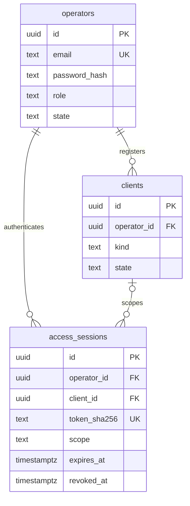
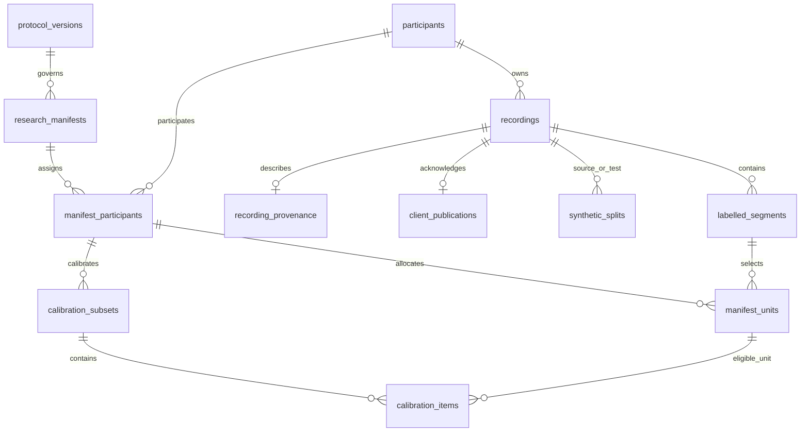
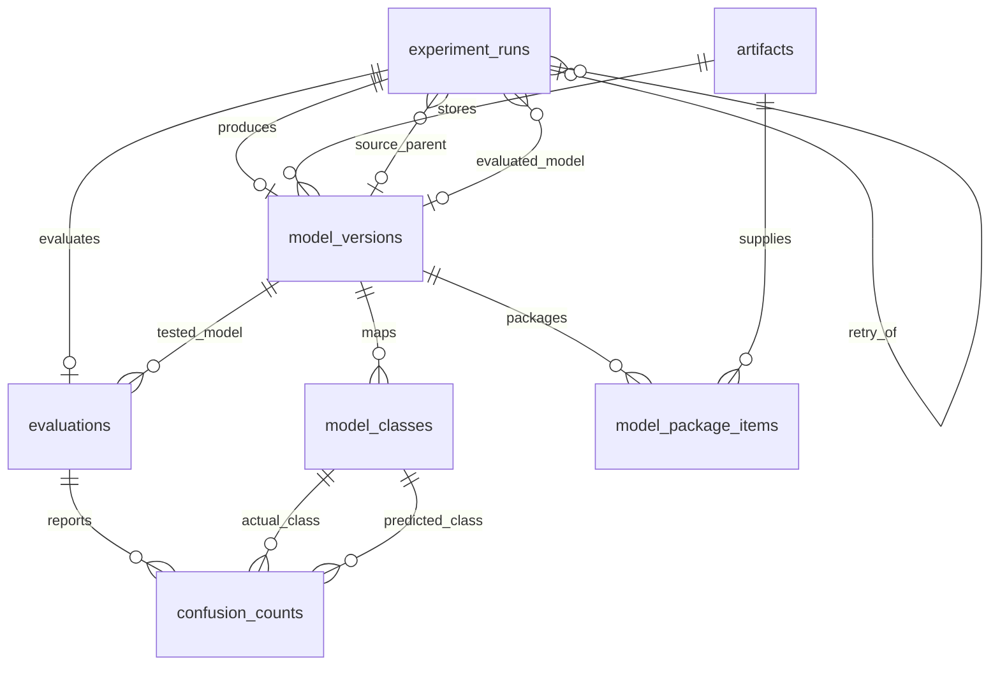
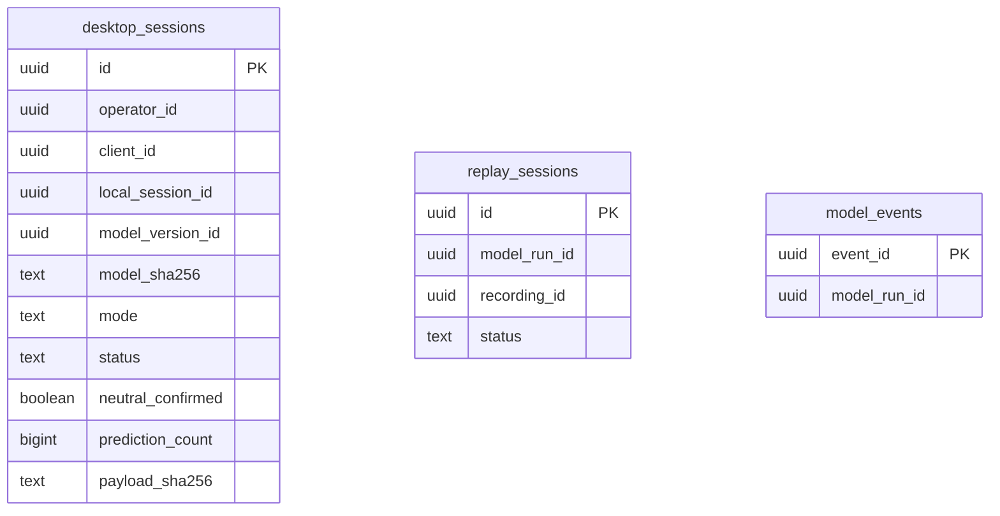

# Current Service Database — Logical Schemas

**Scope:** implemented additive migrations in `services/*/migrations`; historical `myoprosthesis` is documented separately. Tables below are database structure, not evidence of completed cloud APIs or Electron integration.

## Identity — cloud operators

Composite client/owner FK prevents a session from belonging to a different operator's device. Session scope must match the registered client kind. Credentials are digests/encoded hashes, not plaintext. Operator and client revocation remove sessions from `valid_session_ids`. HTTP token issuance and enforcement remain application work.

## Data & Protocol — existing research allocation and new publication provenance

`client_publications(operator_id, client_id, local_recording_id)` is unique. Identical retry returns the existing receipt; changed payload/recording is rejected. `recording_provenance` preserves source version, original identity/hash/coordinates and channel metadata. Legacy records are not automatically research-ready: the existing manifest format/checksums are not silently rewritten, and real-data identity/transformation validation still belongs to ingestion.

## ML Experiments — generic model and result registry

This is distinct from the backwards-compatible `source_lda_runs`, `signal_summary_jobs` and `outbox_events` path. A successful generic fitting run and a published model commit atomically. Evaluation success requires a complete class-pair matrix and mathematically consistent accuracy/macro-F1/rest false-activation rate. The deferred constraint validates final transactional state.

All external identity/manifest/target/calibration UUIDs are checked through their owning APIs, not cross-service joins or cross-schema FKs. Model/run/artifact/class FKs shown here are within the ML boundary. Local workers have no direct database login. Lease identity/expiry gates completion; retries use a new run linked to the old attempt.

## Recognition — synchronized desktop reports

There are no FKs between these three tables. `replay_sessions`/`model_events` are the existing development path; `desktop_sessions` stores immutable terminal client reports with unique client/session identity. Model/account/recording references are external and API-validated. Neutral confirmation records actual evidence; a failed confirmation is retained rather than invented as success.

## PNG exports

- [Identity](SERVICE_MODEL_IDENTITY.png)
- [Data and Protocol](SERVICE_MODEL_DATA.png)
- [Models and evaluations](SERVICE_MODEL_RESEARCH.png)
- [Desktop and legacy recognition](SERVICE_MODEL_RECOGNITION.png)

## Reading and reviewing

- [Teacher review README](README_TEACHER.md)
- [Generated service dictionary](SERVICE_DATA_DICTIONARY.md)
- [Generated service DDL](service_schema.sql)
- [Existing complete logical model](LOGICAL_MODEL.md)
- [Implementation and limitations](IMPLEMENTATION.md)
