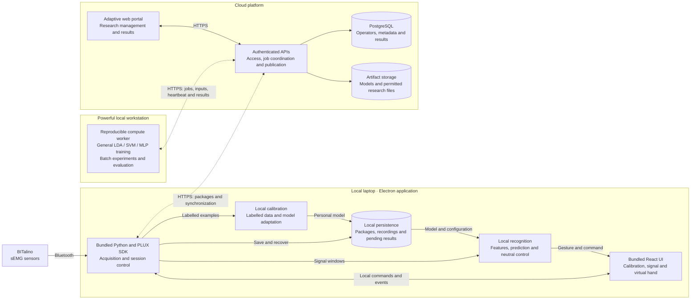

# MyoControl — Accepted Deployment Architecture

**Status:** accepted target; implementation incomplete. 
**Updated:** 23 November 2026 
**Decision record:** [ADR-001](ARCHITECTURE_DECISIONS.md)

Cloud hosts operator access, research management and central storage. General training runs on a powerful local workstation. Electron packages local calibration/adaptation and live recognition.

Solid arrows show local/in-platform interaction. Dashed links are network exchange. No cloud hop occurs between acquisition and live hand commands. Cloud job coordination does not mean cloud training.

## Responsibilities and main flows

| Context | Execution and persistence |
| --- | --- |
| Cloud research | Operator accounts, access control, protocols, metadata, model registry/artifacts, results and job coordination; adaptive browser portal. |
| General training | Local workstation claims a versioned job through APIs, trains/evaluates, then uploads verified models, metrics and provenance. It has no direct cloud database access. |
| Calibration | Electron collects labelled target data and adapts the model locally. Each method's package size, memory and adaptation time must be measured. |
| Live/replay | Device or cached recording → local processing/model → command → Electron hand. Cloud availability is outside the per-window path. |
| Synchronization | Stable IDs/checksums and resumable/idempotent publication distinguish local pending work from cloud-published records. |

The Mac mini is an infrastructure option, not a required logical node or an already established cloud host. Provider and resource sizing remain deployment choices.

1. **Train:** research portal creates a job → authorized local worker obtains inputs → trains/evaluates → cloud validates/publishes output. Unavailable workers leave training waiting/unavailable.
2. **Prepare client:** authenticate → obtain compatible model/adaptation package → verify contracts and integrity → cache locally.
3. **Calibrate:** guide gestures/rest → validate eligible subset/budget → adapt locally → create a new personal version with parent/provenance.
4. **Run live:** BITalino → SDK → windows/features → local model → command/hand. Stop/pause or input/processing failure causes neutral; failures require explicit restart.
5. **Sync:** upload permitted artifacts/results → cloud validates/publishes → mark local transfers complete; interrupted transfers remain pending.

## Delivery and acceptance

- Electron embeds the local UI and automatically manages bundled Python/SDK startup, health and shutdown. The user installs one application without Docker, manual Python setup or manual workers.
- Ship separate tested OS/CPU builds with permitted demo assets. Native Bluetooth/SDK support is verified per target, including the actual M1 Pro/macOS combination.
- Prepared authorized sessions support local calibration, adaptation, live/replay during network loss. Initial login, uncached downloads and cloud operations require connectivity; offline authorization policy must be defined.
- Desktop/tablet/mobile adaptive requirements apply to the cloud portal. Electron is tested at supported laptop/desktop window sizes, without a mobile live/calibration requirement.
- Model/adaptation packages include contract/runtime versions and required source statistics or bounded fixed source/replay pools. Live samples do not automatically train the model.
- Preserve nested budgets, frozen tests, versioned class/channel/feature mappings and provenance. Two-channel support is a separate protocol decision; channel padding is forbidden.
- Reproduce general training outside the author's workstation and rehearse clean install, real acquisition, calibration, live, neutral behaviour, offline operation and synchronization.

## Current gaps

The existing Compose is single-host development infrastructure. The gateway now implements operator sessions, client provisioning/revocation and owner-scoped registry reads. Electron packaging, direct SDK acquisition, local adaptation, remote-worker job/publication APIs and synchronization require implementation. Database support for accounts, registries, receipts and reports is implemented in the new migrations; see [teacher guide](../database/README_TEACHER.md). Architecture diagrams do not establish runtime performance or hardware compatibility.

## Related documents

- [Accepted decisions](ARCHITECTURE_DECISIONS.md)
- [Design PRD](DESIGN_PRD.md)
- [Project requirements](PROJECT_REQUIREMENTS.md)
- [Service implementation](../architecture/README.md)
- [Database logical model](../database/LOGICAL_MODEL.md)
- [PNG diagram](DEPLOYMENT_ARCHITECTURE.png)
