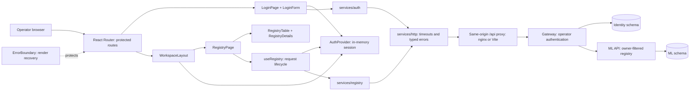
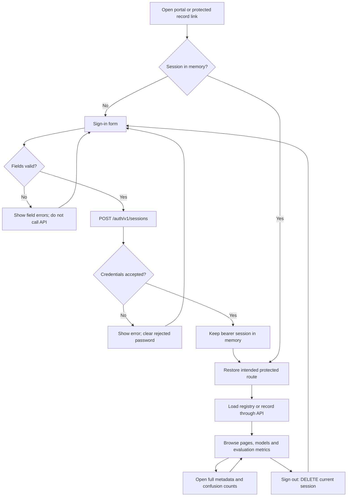
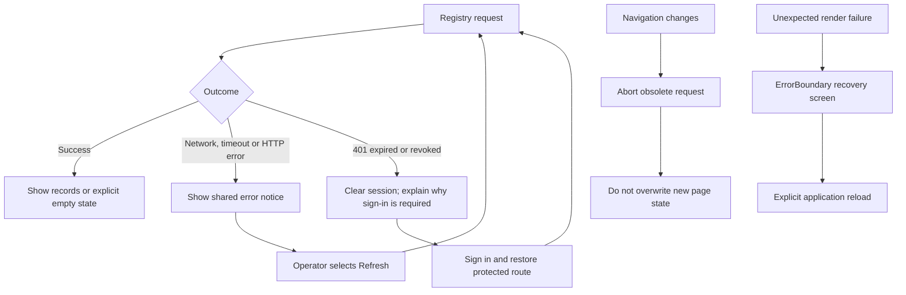

# Cloud frontend architecture

This document describes the implemented research portal. Cloud storage/API services, general training on a local workstation and Electron acquisition/calibration/live recognition remain separate execution boundaries. The browser currently provides operator access and read-only research registries.

## Structure

| Directory/file                     | Responsibility                                                                                                          |
| ---------------------------------- | ----------------------------------------------------------------------------------------------------------------------- |
| `App.tsx`                          | Application composition and route declarations.                                                                         |
| `pages/`                           | Login page and reusable registry page for experiments, models and results.                                              |
| `components/`                      | Carbon shell, login form, registry table/detail, shared API-error notice and render boundary.                           |
| `context/AuthContext.tsx`          | Session ownership, sign-in/sign-out and centralized expired-session handling.                                           |
| `hooks/useRegistry.ts`             | Loading/error/success state; abort requests when navigation changes.                                                    |
| `services/`                        | HTTP transport and domain-specific API calls; no UI rendering.                                                          |
| `types/cloud.ts`                   | Cloud account and registry response types.                                                                              |
| `config/collections.ts`            | Registry names, paths, icons and descriptions.                                                                          |
| `utils/format.ts`                  | Shared display formatting; absent metrics remain N/A.                                                                   |
| `local-preview/`                   | Earlier chart/hand preview and styles, retained for future Electron reuse and excluded from the cloud dependency graph. |
| `test/`, `*.test.tsx`, `*.test.ts` | Component and HTTP-client tests.                                                                                        |
| `e2e/`                             | Browser scenarios against the production frontend with controlled HTTP fixtures.                                        |

The three registries share one page because their loading, pagination and navigation behaviour is the same. Each API domain has a service module. There is no generic application framework or duplicated page per database table.

## Routes and navigation

| Route                                             | Access and behaviour                                                      |
| ------------------------------------------------- | ------------------------------------------------------------------------- |
| `/login`                                          | Public; authenticated operators return to their intended protected route. |
| `/experiments`, `/models`, `/results`             | Protected registry lists.                                                 |
| `/experiments/:id`, `/models/:id`, `/results/:id` | Protected record details.                                                 |
| `?page=2`                                         | List pagination preserved when opening details and returning.             |
| Other paths                                       | Redirect to experiments, then sign in if necessary.                       |

React Router controls navigation without full-page reloads. nginx uses the SPA fallback for direct links. Route changes update the document title and focus the page heading. Browser Back returns to the previous registry/page. Mobile/tablet navigation uses Carbon's collapsible side panel; desktop navigation stays visible.

## User flows

## Tech stack justification

| Choice                         | Reason for this project                                                                                                                                |
| ------------------------------ | ------------------------------------------------------------------------------------------------------------------------------------------------------ |
| React                          | Supports the component structure needed by the cloud portal and allows later reuse of suitable components in Electron.                                 |
| TypeScript                     | Makes account, registry and error contracts explicit and catches incompatible component/API usage during the build.                                    |
| Vite                           | Provides the SPA development server, same-origin development proxy and production bundling with limited configuration.                                 |
| React Router                   | Gives registries and details stable URLs, protected navigation, intended-route restoration and browser history.                                        |
| Carbon React and Carbon icons  | Provides a consistent accessible component foundation. White theme, spacing/type tokens and locally bundled IBM Plex keep the interface consistent.    |
| Sass                           | Compiles Carbon's official styles and token-based layout rules.                                                                                        |
| Fetch and React hooks/context  | Sufficient for three read-only registries and a memory-only session; avoids adding a second cache or global state library without a demonstrated need. |
| Vitest, Testing Library, jsdom | Tests form interaction, rendered component behaviour and HTTP error handling without a running database.                                               |
| Playwright                     | Runs complete browser interactions against built assets at the three required viewport sizes.                                                          |
| nginx and Docker               | Serves built assets and forwards `/api` to the existing gateway; the browser receives no database credentials.                                         |

References: [Carbon React](https://carbondesignsystem.com/getting-started/developing/carbon-core/react/), [React](https://react.dev/), [React Router](https://reactrouter.com/), [Vite](https://vite.dev/), [Vitest](https://vitest.dev/), [Playwright](https://playwright.dev/).

## Validation, errors and session boundaries

- `LoginForm` validates required values and email format before calling the API; the server remains authoritative. Loading disables repeated submissions. Rejected passwords are cleared.
- The HTTP client attaches bearer credentials, limits requests to 20 seconds, handles non-JSON error responses and converts failures to `ApiError` with a status. Navigation cancellation is preserved.
- Registry requests use one lifecycle hook and shared error presentation. A 401 clears access and returns to login with an explanation; network failures remain retryable. A failed sign-out keeps the session visible so revocation can be retried.
- `ErrorBoundary` catches rendering failures across the application and provides an explicit reload action. It complements API handling; React boundaries do not catch every asynchronous exception.
- Tokens stay in React memory. No credentials are put in URLs, browser storage, source configuration or logs. A full reload requires sign-in; centrally stored account/research records remain on the server.
- Owner filtering is enforced by the gateway/ML API, never inferred from hidden frontend controls.

## Verification and its limits

The [frontend README](README.md) maps each assessment requirement to code, documentation and commands. Unit tests cover four key components and the HTTP client. Two browser scenarios run at 1440×900, 768×1024 and 390×844.

Playwright intercepts the HTTP boundary with synthetic response fixtures. It tests the built SPA, routing, navigation, validation, pagination, details, recovery and responsive layouts without changing research data or depending on an operator password. It does **not** prove gateway/database integration. The separate [gateway integration tests](../gateway/tests/test_cloud_access.py) cover real PostgreSQL ownership/session behaviour. The deployed app continues to call real APIs; fixtures are confined to `e2e/`.

General training submission, remote worker execution/publication, artifact transfer and Electron synchronization remain outside this implemented read-only portal slice.
